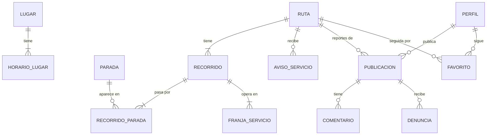
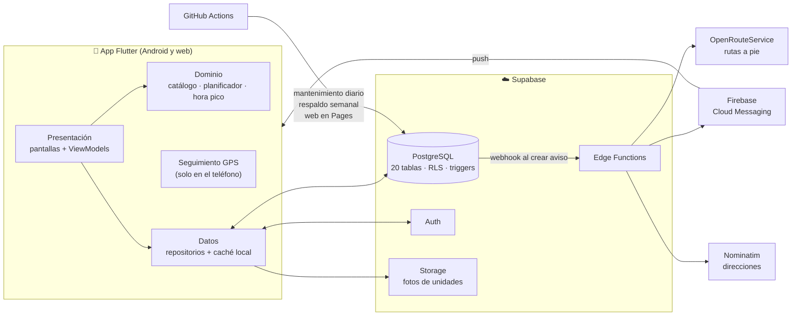

<div align="center">

# 🚌 Camiones Dolores

### Sistema de Información de Transporte · Dolores Hidalgo, Gto.

**Qué camión me lleva, dónde lo tomo, dónde me bajo, cada cuánto pasa y si hoy hay algún cambio.**
Con datos verificables, sin inventar tiempos de llegada.


[**⬇️ Descargar APK**](../../releases/latest) · [🎥 Video](#-video-navegación-de-la-app) · [🗂️ Modelo de datos](docs/MODELO_DE_DATOS.md) · [🛠️ Guía de instalación](GUIA.md)

</div>

---

**Aplicaciones Móviles · Unidad 2 · Grupo GTID243**
**Integrantes:** Jesús Omar Méndez Enríquez · Jesua Emmanuel Rico Pacheco

---

## 📑 Contenido

- [Video: navegación de la app](#-video-navegación-de-la-app)
- [Descargar (Releases)](#️-descargar-releases)
- [El problema y nuestra propuesta](#-el-problema-y-nuestra-propuesta)
- [Perfiles](#-perfiles)
- [Funciones](#-funciones)
- [Modelo de datos](#️-modelo-de-datos)
- [Arquitectura](#️-arquitectura)
- [Tecnologías y servicios gratuitos](#-tecnologías-y-servicios-gratuitos)
- [Seguridad y privacidad](#-seguridad-y-privacidad)
- [Ejecutar el proyecto](#-ejecutar-el-proyecto)
- [Estructura del repositorio](#-estructura-del-repositorio)
- [Créditos](#-créditos)

---

## 🎥 Video: navegación de la app

<!--
  CÓMO PONER EL VIDEO (elige una opción y borra este comentario):

  Opción A — subir el video directo a GitHub (máx. 100 MB):
    1. En GitHub abre este README y dale al lápiz (Edit).
    2. Arrastra el .mp4 aquí abajo, donde dice VIDEO_AQUI.
    3. GitHub pega una línea como https://github.com/user-attachments/assets/xxxx; déjala sola en su renglón y se ve como reproductor.

  Opción B — YouTube (no listado):
    [](https://www.youtube.com/watch?v=ID_DEL_VIDEO)
-->

VIDEO_AQUI

En el video se recorre la app con los tres perfiles: **visitante**, **usuario** y **administrador**.

| Minuto | Qué se muestra |
| --- | --- |
| 0:00 | Inicio, modo visitante y lista de rutas |
| — | Planear un viaje y "avísame cuando llegue" |
| — | Detalle de ruta, horario, hora pico y avisos |
| — | Tablón: reportes y comunidad |
| — | Panel de administración: crear ruta, trazar recorrido y publicar un aviso |

---

## ⬇️ Descargar (Releases)

La app para Android se publica en **[Releases](../../releases/latest)**.

| Archivo | Para quién |
| --- | --- |
| `app-arm64-v8a-release.apk` | **Recomendado.** Casi cualquier Android de los últimos años (~25 MB). |
| `app-release.apk` | Universal, por si el anterior no se instala (~60 MB). |

**Cómo instalarla:**
1. Descarga el `.apk` desde el celular.
2. Ábrelo. Si Android lo pide, permite **instalar apps de fuentes desconocidas**.
3. Si aparece Play Protect, toca **Más detalles → Instalar de todos modos**: sale porque la app no viene de la Play Store.

**Versión web** (sobre todo para el panel de administración): se publica sola en GitHub Pages con cada cambio en `main`.

<details>
<summary><b>Cómo publicar una versión nueva (para el equipo)</b></summary>

```powershell
flutter build apk --release --split-per-abi --dart-define-from-file=config.json
flutter build apk --release --dart-define-from-file=config.json
```

Los archivos quedan en `build/app/outputs/flutter-apk/`. En GitHub: **Releases → Draft a new release** → etiqueta `v1.0.0` → arrastra `app-arm64-v8a-release.apk` y `app-release.apk` → **Publish release**.

Antes de compilar, sube `version:` en `pubspec.yaml` (p. ej. `1.0.1+2`) para que el celular lo instale como actualización.
</details>

---

## 💡 El problema y nuestra propuesta

En Dolores Hidalgo no existe información pública y confiable del transporte urbano: las rutas se conocen de boca en boca, los horarios cambian y los desvíos no se avisan. Las unidades **no tienen GPS**, así que una app que prometa "llega en 5 minutos" estaría inventando.

**Camiones Dolores** es un **sistema de información de transporte** construido con estos principios:

| Principio | Qué significa en la app |
| --- | --- |
| **Dato verificable o nada** | Rutas, paradas y horarios los captura la administración en levantamiento de campo; cada dato tiene fuente y fecha de revisión. |
| **Rangos honestos** | Frecuencias ("cada 10–15 min") y tiempos como rango, nunca una hora exacta de llegada. |
| **La comunidad informa, no decide** | Los reportes del tablón se ven, pero no alteran rutas ni cálculos. El admin los confirma y los convierte en avisos oficiales. |
| **Lo oficial llega al instante** | Cualquier cambio del administrador se notifica por push a quien sigue la ruta. |
| **Funciona sin cuenta y sin señal** | El catálogo se guarda en el teléfono y el planificador corre en el propio celular. |

---

## 👥 Perfiles

| Perfil | Pantalla principal | Qué puede hacer |
| --- | --- | --- |
| **Visitante** *(sin cuenta)* | Rutas disponibles | Consultar rutas, paradas, horarios y hora pico; planear viajes; seguir rutas y recibir avisos; leer el tablón. |
| **Usuario** | Mapa con rutas cercanas | Todo lo anterior, y además reportar, publicar, comentar, marcar "útil", guardar viajes con recordatorio y recibir el aviso de último camión. |
| **Administrador** | Panel de administración *(app y web)* | Rutas, recorridos, paradas, horarios, lugares, avisos, días especiales, reportes de la comunidad, moderación, usuarios y bitácora. |

Toda cuenta nueva es **Usuario**; solo un administrador puede asignar el rol de administrador.

---

## ✨ Funciones

### Para moverse por la ciudad
- 🗺️ **Mapa** (OpenStreetMap) con las rutas y paradas cercanas a ti.
- 🧭 **Planificador de viaje**: rutas directas o con un transbordo, tramos a pie por calles reales y tiempo como rango. Como el camión se para donde le hacen la mano, te dice el punto exacto del recorrido donde tomarlo, no solo la parada registrada.
- 🔔 **"Avísame cuando llegue"**: sigue tu posición con el GPS de tu teléfono (la ubicación no sale de él) y vibra 300 m antes de tu bajada.
- 🟢 **Estado del servicio**: "En servicio · cada 10–15 min" o "Terminó por hoy · mañana inicia 6:00", con calendario de días festivos.
- ⏰ **Hora pico** = horarios de alta demanda: entradas y salidas de escuelas, cambios de turno y tianguis cerca de la ruta.
- 📍 **"¿Qué rutas pasan por aquí?"** desde cualquier punto del mapa.
- 🚶 **Comparar contra caminar** cuando el destino está cerca.

### Para estar enterado
- 📢 **Avisos oficiales con push** instantáneo: desvíos, suspensiones y cambios de horario. Los cambios de recorrido y horario se avisan solos.
- 🌙 **Aviso de último camión** de las rutas que sigues.
- 💾 **Viajes guardados** con recordatorio a la hora de salir.
- 📤 **Compartir viaje** por WhatsApp.

### Para reconocer el camión y pagar
- 📸 **Cómo reconocerlo**: foto de la unidad, letrero del parabrisas y colores.
- 💵 **Tarifas**: general, estudiante e INAPAM, con su fuente.

### Comunidad
- 📣 **Reportes rápidos** (retraso, unidad llena, desvío, no pasó, incidente) en dos toques; se muestran 6 horas.
- 💬 **Tablón** con preguntas, objetos perdidos, comentarios, "útil" y denuncias.
- 🛡️ **Moderación**: con 3 denuncias el contenido se oculta solo, y el admin decide.

### Extras
- 📱 **Widget** de Android con tus rutas.
- 🌐 **Español e inglés**.
- 📶 **Funciona sin conexión** con los datos guardados.

### Panel de administración
- ✅ **Pasos para publicar una ruta**: checklist de lo que falta (trazado, paradas, horario) antes de activarla.
- ✏️ **Editor de recorrido**: trazado tocando el mapa o importando un **GPX**, y paradas en orden con arrastrar y soltar.
- 🕐 **Horarios por franjas** y tipo de día, sin empalmes.
- 📊 **Reportes de la comunidad** agrupados por ruta, con cuántas personas distintas reportan y un botón para convertirlos en aviso oficial.
- 👤 **Usuarios** (roles y suspensión) y **bitácora** de cambios.

---

## 🗂️ Modelo de datos

20 tablas en PostgreSQL con valores controlados (`enum`), integridad referencial, restricciones de dominio y **RLS** en todas las tablas.



📄 **[Ver el modelo completo y su relación con el modelo de dominio original →](docs/MODELO_DE_DATOS.md)**
Ahí se explica entidad por entidad (Usuario, Ruta, Parada, RutaParada, HoraPico, Reporte, Reputación) y cómo se atendió cada una de las **observaciones del esquema**.

---

## 🏗️ Arquitectura



- **Patrón MVVM** con `ChangeNotifier`, en capas `data / domain / presentation`.
- **El planificador corre en el teléfono**: no depende del servidor y funciona sin señal.
- **Notificaciones al instante**: un trigger de la base crea el aviso, un *database webhook* llama a la Edge Function y esta envía el push por FCM a los temas `ruta_<id>`.

---

## 🧰 Tecnologías y servicios gratuitos

| Servicio | Para qué | Plan |
| --- | --- | --- |
| **Supabase** | Base de datos, autenticación, almacenamiento y funciones | Free |
| **Firebase Cloud Messaging** | Notificaciones push | Gratis |
| **OpenStreetMap** | Mapa base | Libre |
| **OpenRouteService** | Rutas a pie por calles reales | Free (con caché) |
| **Nominatim** | Buscar direcciones | Libre (con caché) |
| **GitHub Actions + Pages** | Respaldos, mantenimiento y versión web | Gratis |

**Sin costo durante el año del proyecto:** un workflow diario evita que Supabase pause el proyecto por inactividad, y otro respalda la base cada semana.

---

## 🔒 Seguridad y privacidad

- Contraseñas con **hash bcrypt** (Supabase Auth); la app nunca las guarda.
- **Row Level Security** en las 20 tablas: cada quien solo puede leer y escribir lo que le corresponde.
- **Anti-abuso:** máximo 5 publicaciones por hora y 1 reporte igual por ruta cada 30 min; con 3 denuncias el contenido se oculta.
- **La ubicación no sale del teléfono**: el seguimiento del viaje se calcula en el propio celular y no se guarda en el servidor.
- **Eliminar cuenta** borra los datos personales y deja las publicaciones como "Usuario eliminado".
- Las claves privadas (Firebase, base de datos) **no están en el repositorio**: viven en los *secrets* de Supabase y GitHub.

---

## 🚀 Ejecutar el proyecto

> La guía completa (Supabase, Firebase, APIs, webhooks y GitHub) está en **[GUIA.md](GUIA.md)**.

**Requisitos:** Flutter 3.x, Android SDK (o Chrome) y una cuenta de Supabase.

```bash
git clone https://github.com/<usuario>/app_buses.git
cd app_buses
cp config.example.json config.json   # pon tu SUPABASE_URL y SUPABASE_ANON_KEY
flutter pub get
flutter run --dart-define-from-file=config.json
```

```json
{ "SUPABASE_URL": "https://xxxx.supabase.co", "SUPABASE_ANON_KEY": "sb_publishable_..." }
```

**Base de datos:** `supabase link` y `supabase db push` aplican las migraciones de `supabase/migrations/`.

---

## 📁 Estructura del repositorio

```
lib/
├── core/           configuración, tema, idioma, geometría, tiempo, validaciones
├── domain/         entidades, catálogo, planificador, hora pico
├── data/           repositorios (Supabase) y caché local
├── servicios/      notificaciones, seguimiento GPS, widget
└── presentation/
    ├── viewmodels/
    ├── widgets/
    └── pages/      acceso · visitante · usuario · comun · admin
supabase/
├── migrations/     esquema, lógica y seguridad
├── functions/      enviar-push · ruta-a-pie · geocodificar
├── pruebas/        pruebas del esquema en PostgreSQL
└── seed.sql        datos de ejemplo
docs/
└── MODELO_DE_DATOS.md
.github/workflows/  mantenimiento · respaldo · web
```

---

## 🙌 Créditos

Mapa © colaboradores de [OpenStreetMap](https://www.openstreetmap.org/copyright) · Rutas a pie: [openrouteservice.org](https://openrouteservice.org) · Direcciones: [Nominatim](https://nominatim.org).

<div align="center">
<sub>Hecho en Dolores Hidalgo, Gto. 🇲🇽</sub>
</div>
