# Camiones Dolores

## 1. Descripción breve

App móvil hecha en Flutter para consultar las rutas de camiones cercanas, ver su próximo horario y reportar el paso de un camión. Usa datos de ejemplo (mock) y arquitectura por capas (`data` / `domain` / `presentation`) con MVVM.

**Integrantes:** Jesús Omar Méndez Enríquez · Jesua Emmanuel Rico Pacheco

## 2. Los 3 tipos de usuario y sus dashboards

| Usuario | Dashboard | Qué puede hacer |
|---|---|---|
| **Administrador** | Panel de administración | Gestiona las rutas: **agrega y edita** (nombre, color, frecuencia, activa). Ve métricas (usuarios, rutas activas, reportes) y todos los reportes. |
| **Alumno** | Mapa + rutas cercanas | Busca rutas por destino, ve el próximo camión, reporta el paso de un camión y consulta reportes y su perfil (con reputación). |
| **Visitante** | Rutas disponibles | Consulta las rutas y la hora pico, y puede reportar un camión y ver los reportes. |

Los roles siguen el modelo de dominio del proyecto (tabla `Usuario`): el alumno y el visitante reportan, el admin gestiona rutas.

El dashboard se elige según el rol con el que se inicia sesión o se registra la persona.

## 3. Manejo de estado elegido (y por qué)

**`ChangeNotifier` + `ListenableBuilder` (patrón MVVM, sin paquetes externos).**

- Ya venía en el proyecto (`InicioViewModel`), así que seguimos la misma convención en toda la app.
- Es el manejo de estado que trae Flutter de fábrica: no agrega dependencias y es fácil de explicar.
- Se crea **un solo juego de ViewModels** en `main.dart` (`SesionViewModel`, `InicioViewModel`, `ReportesViewModel`, `RutasAdminViewModel`) y se pasa a las pantallas. Por eso el rol, los datos y las listas **persisten al navegar** entre pantallas mientras la app está abierta.
- Para el tamaño de esta entrega (solo vista y validaciones) no se justifica Provider/Riverpod/Bloc.

## 4. Cómo ejecutar la app

Requisitos: Flutter instalado y un emulador o dispositivo conectado.

```bash
git clone <url-del-repo>
cd <carpeta-del-repo>
flutter pub get
flutter run
```

Usuarios de prueba (contraseña `123456`):

| Rol | Correo |
|---|---|
| Administrador | admin@camiones.com |
| Alumno | alumno@camiones.com |
| Visitante | visitante@camiones.com |

También se puede crear una cuenta nueva desde "Regístrate" eligiendo el rol.

## 5. Demostración al docente

- Dispositivo/emulador usado: **Samsung Galaxy A55 5G (Android)**. Probamos la app instalándola y ejecutándola directamente en el celular desde Flutter.
- Fecha y modalidad de la demostración: [escribe aquí la fecha · presencial / videollamada]

## 6. Screenshots

### Splashscreen
**Pantalla de carga inicial, antes de pasar al login**
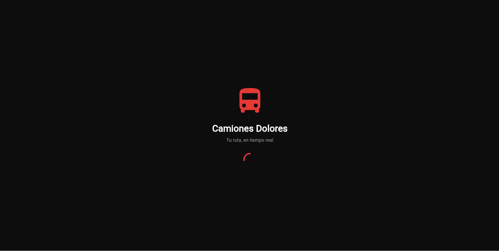

### Autenticación
**Inicio de sesión con validación de campos (errores visibles)**
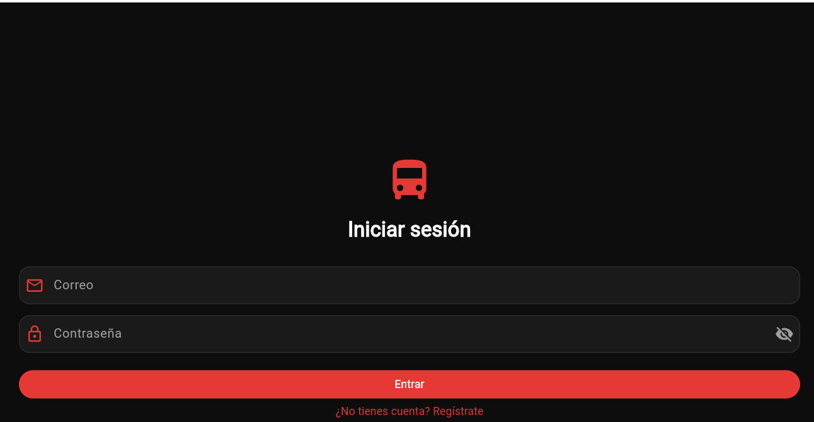

**Registro de usuario con selección de rol (Alumno, Visitante o Administrador)**
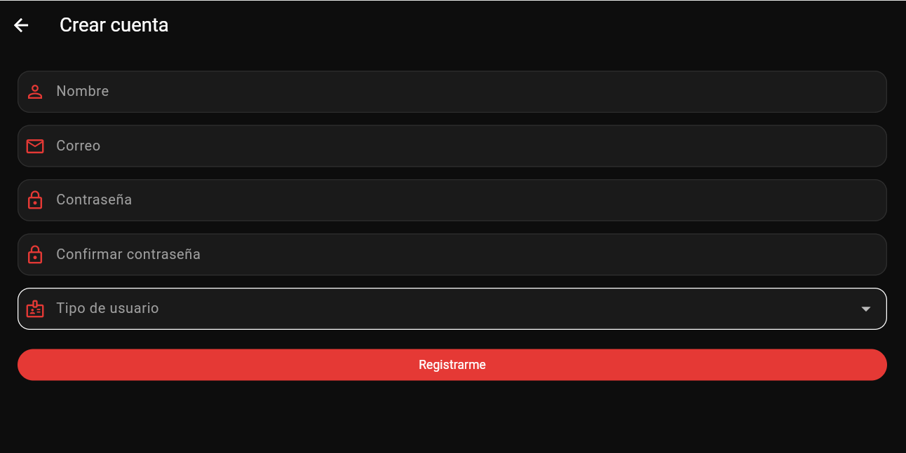

### Dashboards
**Dashboard del Administrador: métricas y gestión de rutas**
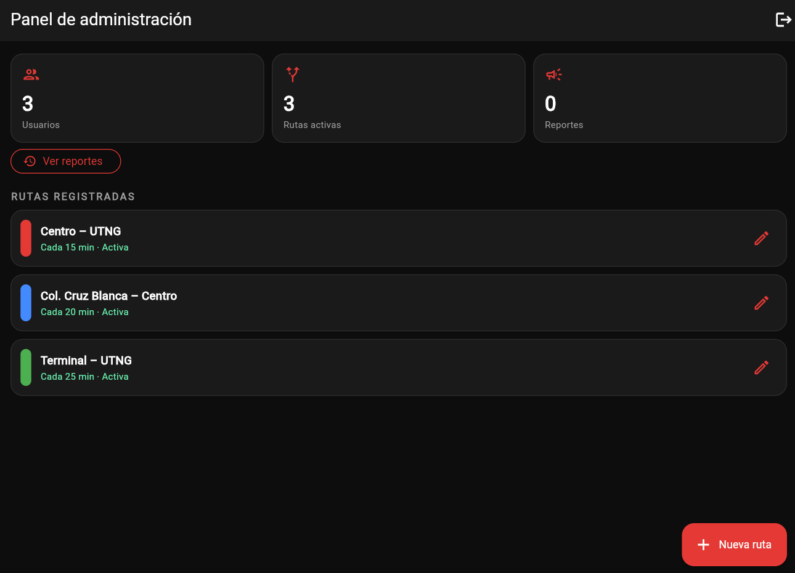

**Dashboard del Alumno: mapa, buscador de destino y rutas cercanas**
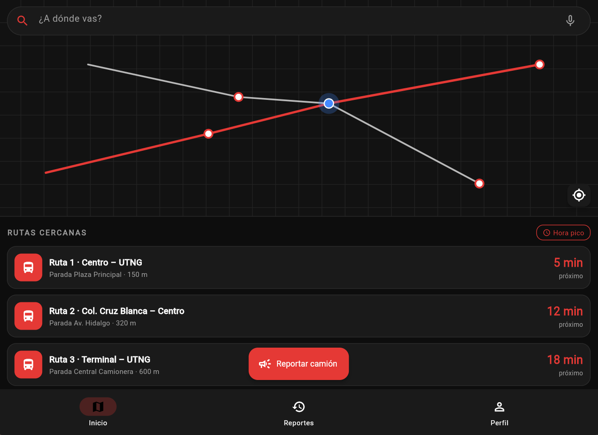

**Dashboard del Visitante: rutas disponibles y botón para reportar**
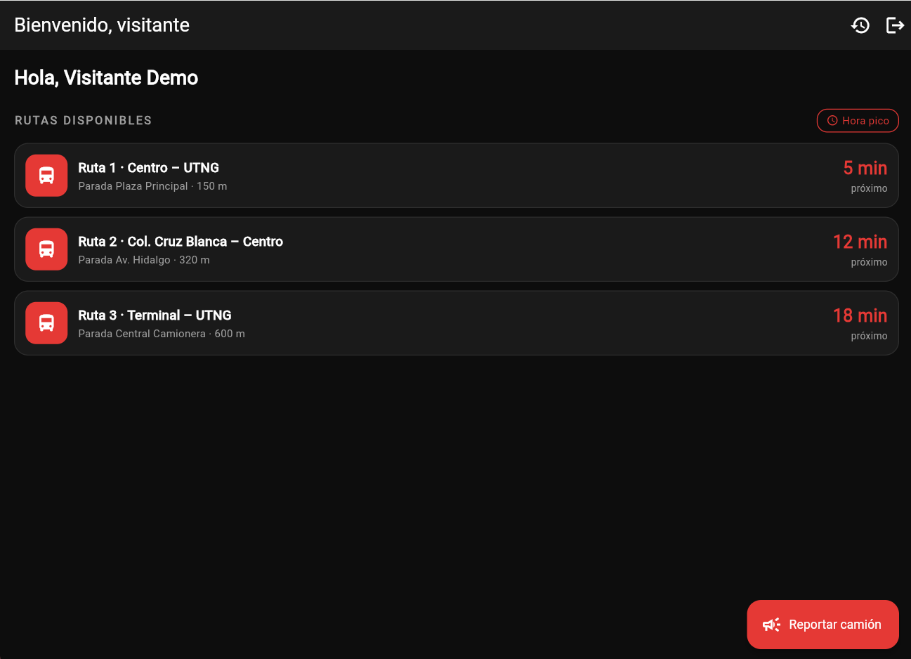

### Listas
**Lista principal: rutas cercanas con datos dinámicos**
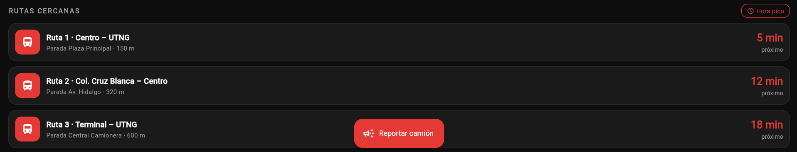

**Lista secundaria: reportes de camiones con su detalle**
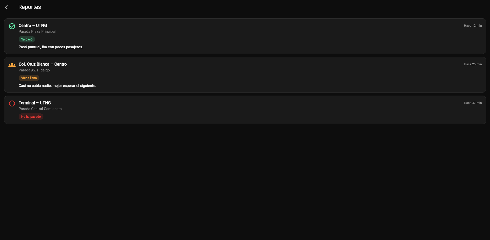

**Estado vacío: sin resultados al buscar un destino que no existe**
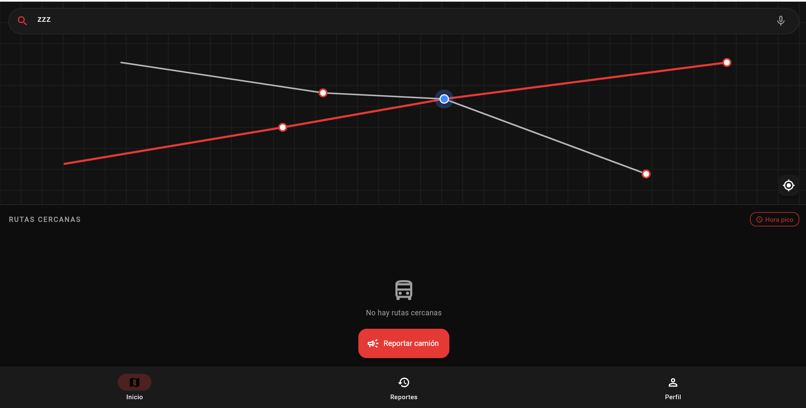

### Formularios
**Formulario de reporte de camión (Alumno y Visitante) con validación**
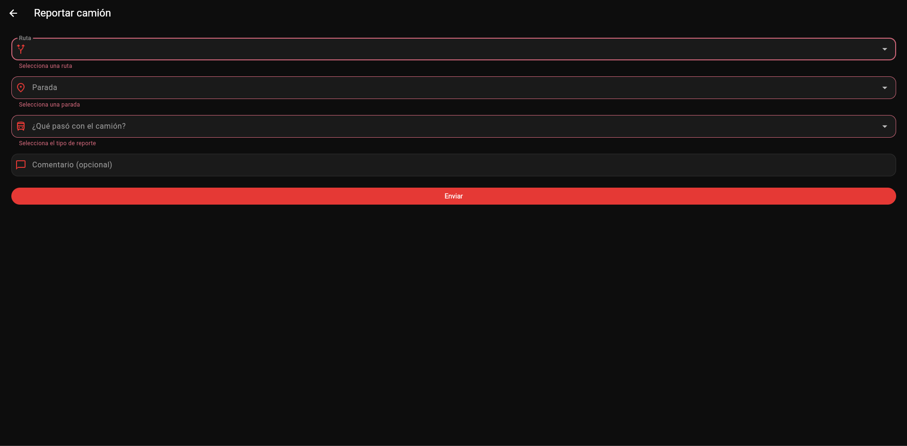

**Formulario de ruta del Administrador (agregar y editar) con validación**
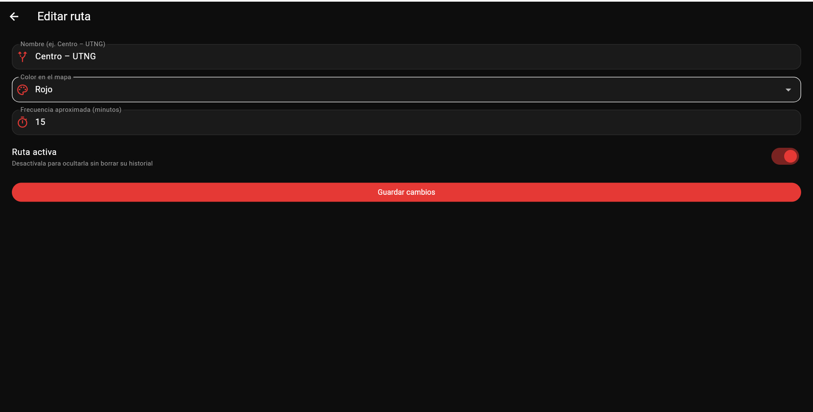

### Evidencia funcional
**La app corriendo en el Samsung Galaxy A55 5G**


**Video del flujo de navegación: login → dashboard → lista → formulario**

PEGA-AQUI-EL-VIDEO