# Modelo de datos

Este documento relaciona el **modelo de dominio original** (Unidad 2, *Pantallas obligatorias*) con el esquema implementado en Supabase (`supabase/migrations/`). Para cada entidad original se indica dónde quedó, y para cada **observación del esquema** que hizo el profesor, cómo se resolvió.

> El esquema completo, con sus restricciones, está en [`20261126000001_esquema.sql`](../supabase/migrations/20261126000001_esquema.sql). La lógica (triggers y funciones) está en [`…0002_logica.sql`](../supabase/migrations/20261126000002_logica.sql) y la seguridad (RLS) en [`…0003_seguridad.sql`](../supabase/migrations/20261126000003_seguridad.sql).

---

## 1. Diagrama entidad-relación

```mermaid
erDiagram
    PERFIL ||--o{ PUBLICACION : publica
    PERFIL ||--o{ COMENTARIO : comenta
    PERFIL ||--o{ VOTO_UTIL : marca
    PERFIL ||--o{ DENUNCIA : denuncia
    PERFIL ||--o{ FAVORITO : sigue
    PERFIL ||--o{ VIAJE_GUARDADO : guarda
    PERFIL ||--o{ DISPOSITIVO : registra
    PERFIL ||--o{ BITACORA_ADMIN : "hace (admin)"

    RUTA ||--|{ RECORRIDO : "tiene (ida, vuelta o circuito)"
    RECORRIDO ||--|{ RECORRIDO_PARADA : "pasa por (en orden)"
    PARADA ||--o{ RECORRIDO_PARADA : "aparece en"
    RECORRIDO ||--|{ FRANJA_SERVICIO : "opera en"
    RUTA ||--o{ AVISO_SERVICIO : "recibe"
    AVISO_SERVICIO ||--o{ AVISO_PARADA : afecta
    PARADA ||--o{ AVISO_PARADA : "afectada por"
    DIA_ESPECIAL }o--o| AVISO_SERVICIO : "puede tener"
    LUGAR ||--|{ HORARIO_LUGAR : "entradas y salidas"

    RUTA ||--o{ PUBLICACION : "reportes sobre"
    PARADA ||--o{ PUBLICACION : "reportes en"
    PUBLICACION ||--o{ COMENTARIO : tiene
    PUBLICACION ||--o{ VOTO_UTIL : recibe
    PUBLICACION ||--o{ DENUNCIA : recibe
    RUTA ||--o{ FAVORITO : "seguida por"

    PERFIL {
        uuid id PK "= auth.users"
        varchar nombre
        enum rol "usuario | admin"
        enum estado "activa | suspendida"
        bool notif_rutas
        varchar idioma
    }
    RUTA {
        serial id_ruta PK
        varchar nombre UK
        char color
        numeric tarifa
        numeric tarifa_estudiante
        numeric tarifa_inapam
        varchar concesionario
        bool activa
        date revisada_en
    }
    RECORRIDO {
        serial id_recorrido PK
        int id_ruta FK
        enum sentido "ida | vuelta | circuito"
        jsonb trazado "[lng, lat] en orden"
    }
    PARADA {
        serial id_parada PK
        varchar nombre
        numeric latitud
        numeric longitud
        bool activa
    }
    RECORRIDO_PARADA {
        int id_recorrido PK
        int id_parada PK
        smallint orden UK
        smallint min_desde_inicio
    }
    FRANJA_SERVICIO {
        serial id_franja PK
        int id_recorrido FK
        enum tipo_dia
        time hora_inicio
        time hora_fin
        smallint frecuencia_min
        smallint frecuencia_max
        enum fuente
    }
    LUGAR {
        serial id_lugar PK
        varchar nombre
        enum categoria
        numeric latitud
        numeric longitud
    }
    HORARIO_LUGAR {
        serial id_horario PK
        int id_lugar FK
        enum tipo_dia
        time hora
        enum evento "entrada | salida | cambio_turno | tianguis"
        enum fuente
    }
    AVISO_SERVICIO {
        serial id_aviso PK
        int id_ruta FK "null = general"
        enum tipo
        varchar titulo
        timestamptz vigente_desde
        timestamptz vigente_hasta
        bool automatico
    }
    PUBLICACION {
        serial id_publicacion PK
        uuid id_usuario FK
        enum categoria "retraso | unidad_llena | desvio | no_paso | incidente | ..."
        varchar texto
        int id_ruta FK
        int id_parada FK "opcional"
        enum estado "visible | oculto"
        timestamptz creado_en
    }
    DENUNCIA {
        serial id_denuncia PK
        enum estado "pendiente | procedente | improcedente"
        uuid resuelta_por FK
        timestamptz resuelta_en
    }
```

*(GitHub dibuja este diagrama automáticamente.)* Faltan en el dibujo, por espacio, `DISPOSITIVO`, `FAVORITO`, `VIAJE_GUARDADO`, `COMENTARIO`, `VOTO_UTIL`, `AVISO_PARADA`, `DIA_ESPECIAL`, `BITACORA_ADMIN` y `CACHE_API`. Son 20 tablas en total.

---

## 2. De dónde viene cada entidad original

| Entidad original | En el esquema actual | Qué cambió y por qué |
| --- | --- | --- |
| **Usuario** | `perfil` + `auth.users` (Supabase Auth) | La contraseña la guarda Supabase Auth con **bcrypt**; nunca pasa por nuestras tablas. `perfil` guarda nombre, rol, estado y preferencias. |
| **Ruta** | `ruta` | Se agregaron tarifas (general, estudiante, INAPAM) con su fuente, letrero, foto, descripción de la unidad, concesionario y fecha de última revisión. `frecuencia_aprox_min` pasó a `franja_servicio` (ver observaciones). |
| **Parada** | `parada` | Igual que el original, más una referencia ("frente al OXXO") y la validación de que las coordenadas estén dentro del municipio. |
| **RutaParada** | `recorrido` + `recorrido_parada` | Una ruta ahora tiene **recorridos** (ida, vuelta o circuito), cada uno con su trazado sobre las calles y sus paradas en orden. `unique (id_recorrido, orden)` y la PK `(id_recorrido, id_parada)` evitan órdenes duplicados y paradas repetidas. |
| **HoraPico** | `lugar` + `horario_lugar` (y `franja_servicio`) | En lugar de que alguien capture "nivel alto de 7 a 8", se registran **hechos verificables** ("la UTNG entra a las 7:00", "tianguis los martes"). La app calcula la hora pico de cada ruta con los lugares que están a ≤400 m de su recorrido. Ver la sección 4. |
| **Reporte** | `publicacion` (categorías de reporte) | Mismos tipos (retraso, unidad llena, desvío, incidente, no pasó), con ruta, parada opcional, fecha y hora automáticas. Se suman los comentarios, el "útil", las denuncias y la moderación. |
| **Reputación** | `v_perfil_resumen` (vista) | Es un valor **derivado**, nunca capturado: publicaciones visibles y "útil" recibidos. |
| *(nuevo)* | `aviso_servicio`, `aviso_parada`, `dia_especial` | Información **oficial** del administrador (desvíos, suspensiones, días festivos), notificada por push. |
| *(nuevo)* | `favorito`, `dispositivo`, `viaje_guardado` | Seguir rutas, recibir notificaciones y guardar viajes frecuentes. |
| *(nuevo)* | `bitacora_admin`, `cache_api` | Auditoría de cambios del admin, y caché de las APIs externas para no rebasar sus límites gratuitos. |

---

## 3. Observaciones del esquema y cómo se resolvieron

| # | Observación del profesor | Resolución | Dónde |
| --- | --- | --- | --- |
| 1 | Usuario necesita `contrasena_hash` | ✅ Supabase Auth guarda el hash (bcrypt) en `auth.users`. La app nunca ve ni guarda la contraseña. | Supabase Auth |
| 2 | `rol`, `tipo`, `dia_semana` y `nivel` con valores controlados | ✅ Todo es `enum` de PostgreSQL: `rol_usuario`, `estado_cuenta`, `sentido`, `tipo_dia`, `tipo_aviso`, `categoria_pub`, `tipo_evento`, `fuente_dato`… `dia_semana` tiene `check (between 1 and 7)`. | `…0001_esquema.sql` |
| 3 | Reporte necesita estado de revisión y quién decidió si es confiable | ✅ / ⚠️ `publicacion.estado` (visible/oculto) y `denuncia.estado` (pendiente/procedente/improcedente) con `resuelta_por` y `resuelta_en`. Un reporte confirmado por el admin se publica como **aviso oficial**, con su autor y su fecha en `bitacora_admin`. | `denuncia`, `resolver_denuncia()` |
| 4 | Definir descripción y ubicación del reporte | ✅ Descripción: `texto` (3–500 caracteres; en los reportes rápidos se llena sola si el usuario no escribe). Ubicación: la **parada** (opcional). La ubicación GPS **no se guarda**, por privacidad. | `publicacion` |
| 5 | Validar que HoraPico no tenga horarios duplicados o empalmados | ✅ `franja_servicio` tiene una restricción `EXCLUDE USING gist` que impide franjas empalmadas del mismo recorrido y tipo de día. `horario_lugar` tiene un índice único contra duplicados. | `franjas_sin_empalme` |
| 6 | La reputación es un valor derivado | ✅ Es una vista (`v_perfil_resumen`) calculada a partir de la actividad; no hay columna que se pueda editar. | `…0002_logica.sql` |
| 7 | Faltan horarios de salida, tarifas, sentido y paradas terminales | ✅ Horarios: `franja_servicio` (inicio, fin y frecuencia por tipo de día). Tarifas: `ruta.tarifa*`. Sentido: `recorrido.sentido`. Terminales: la primera y la última parada (`orden`) de cada recorrido. Además, minutos desde la terminal por parada (`min_desde_inicio`). | `franja_servicio`, `recorrido` |
| 8 | No incluye favoritos ni notificaciones | ✅ Entraron al alcance: `favorito`, `dispositivo` (token FCM), preferencias en `perfil.notif_*` y push automático al cambiar una ruta. | `favorito`, `enviar-push` |
| 9 | Parada opcional en ciertos tipos de reporte | ✅ `publicacion.id_parada` admite null: un "no ha pasado" puede referirse a toda la ruta. | `publicacion` |
| 10 | `frecuencia_aprox_min` no representa las variaciones en hora pico | ✅ Se sustituyó por **franjas**: cada recorrido tiene varias (p. ej. 6:00–9:00 cada 8–12 min; 9:00–13:00 cada 15–20 min), distintas para laborable, sábado y domingo. | `franja_servicio` |
| 11 | Definir si las rutas tienen empresa o concesionario | ✅ `ruta.concesionario` (opcional) y `fuente_dato` incluye `'concesionario'`. | `ruta` |

---

## 4. Decisiones de diseño respecto al modelo original

**No hay GPS en las unidades, así que no hay posición en vivo ni "llega en 5 minutos".** El modelo se centra en lo que se puede verificar: recorridos, paradas, horarios por franjas y avisos oficiales. Los tiempos se muestran como **rango** a partir de la frecuencia.

**HoraPico ya no es un nivel capturado a mano.** Un "nivel alto de 7:00 a 8:00" no tiene fuente: nadie mide la afluencia. En cambio, "la secundaria entra a las 7:00" se puede comprobar. Con esos hechos, la app marca como horario de alta demanda la media hora antes y la media hora después de cada entrada o salida de los lugares que están cerca del recorrido.

**Los reportes informan, pero no deciden.** Lo que publica la comunidad nunca cambia rutas ni horarios. El administrador los ve agrupados por ruta (con cuántas personas distintas reportan) y, si confirma un problema, lo convierte en un aviso oficial que sí llega como notificación.

**Las rutas se desactivan, no se borran.** Así se conserva el historial. Un trigger impide activar una ruta sin recorrido, sin al menos 2 paradas o sin horario.

---

## 5. Integridad y seguridad en la base de datos

- **RLS (Row Level Security) en todas las tablas:** el público solo lee lo activo; solo el admin escribe el catálogo; cada usuario solo modifica lo suyo.
- **Triggers:** límites anti-abuso (5 publicaciones por hora y 1 reporte igual por ruta cada 30 min), 3 denuncias ocultan el contenido, bitácora automática de los cambios del admin, aviso automático cuando cambia un recorrido o un horario, y campos protegidos del perfil (nadie puede subirse a admin).
- **Funciones RPC transaccionales:** `guardar_recorrido` y `guardar_franjas` reemplazan todo o nada.
- **Coordenadas validadas** dentro del municipio, colores `#RRGGBB`, tarifas ≥ 0 y frecuencia mínima ≤ máxima.
- **Eliminar cuenta:** las publicaciones se conservan anonimizadas (`id_usuario = null`, "Usuario eliminado").
